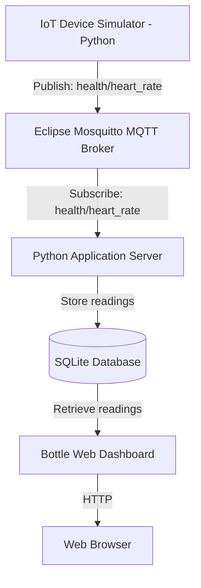

# Secure IoT Health Monitoring System

An event-driven IoT application for collecting, transmitting,
storing and visualizing simulated heart-rate data using MQTT,
Python and SQLite.

Originally developed in August 2024, this repository reconstructs the
documented implementation and serves as a foundation for
further security and scalability improvements.

## Project Overview

The system simulates IoT devices transmitting heart-rate
measurements to a centralized application server through an
MQTT message broker.

The application server processes incoming messages, persists
the readings in a database and provides a web interface for
viewing and filtering historical data.

## Project Motivation and Significance

The increasing adoption of Internet of Things (IoT) devices across healthcare, transportation, industrial automation and other sectors has created a growing need for secure, efficient and reliable device-to-server communication.

In healthcare, connected devices can facilitate continuous remote patient monitoring by transmitting physiological measurements to centralized application servers. However, inadequate security mechanisms can expose sensitive information to unauthorized access, interception and manipulation.

This project explores the use of MQTT as a lightweight messaging protocol for resource-constrained IoT environments, alongside security mechanisms intended to protect data confidentiality and integrity.

Using simulated heart-rate monitoring as a practical use case, the project investigates:

- Efficient asynchronous device-to-server communication.
- Secure transmission of sensitive information.
- Device authentication and topic-level authorization.
- Reliable data processing and persistence.
- System observability, performance and scalability.

Although healthcare is the primary use case, the underlying architectural principles are applicable to industrial IoT, connected vehicles, smart infrastructure and other distributed systems.

The project serves as a proof of concept rather than a production-ready healthcare application.

## System Architecture



The system consists of three containerized services:

- **Device Simulator-Raspberry Pi:** Simulates heart-rate measurements
  from five IoT users.
- **MQTT Broker:** Facilitates asynchronous communication
  between the publisher and subscriber.
- **Application Server:** Processes incoming readings,
  manages database persistence and serves the web dashboard.

## Technology Stack

| Technology        | Purpose                        |
|-------------------|--------------------------------|
| Python 3.11       | Application development        |
| Eclipse Mosquitto | MQTT message broker            |
| MQTT              | Lightweight messaging protocol |
| Paho MQTT         | MQTT client library            |
| Bottle            | Web application framework      |
| SQLite            | Data persistence               |
| Docker            | Containerization               |
| Docker Compose    | Multi-container orchestration  |

## Features

- Simulated IoT heart-rate data generation.
- Asynchronous publisher-subscriber communication.
- MQTT-based message transmission.
- Persistent storage of heart-rate readings.
- Web-based data visualization.
- Search and filtering by device ID.
- Containerized application components.
- Persistent database storage using Docker volumes.

## MQTT Configuration

| Parameter           | Value               |
|---------------------|---------------------|
| Broker              | Eclipse Mosquitto   |
| Port                | 1883                |
| Topic               | health/heart_rate   |
| Message format      | CSV                 |
| Simulated users     | 5                   |
| Heart-rate range    | 60–100 bpm          |
| Publishing interval | 5 seconds per batch |

Example MQTT messages:

```text
John,83
Jane,75
Sarah,92
Rob,68
Steph,87
```

## Getting Started

### Prerequisites

- Docker
- Docker Compose
- Git

### Installation

Build and start the services:

```bash
docker compose up --build -d
```

Verify the running containers:

```bash
docker compose ps
```

Access the dashboard:

http://localhost:8080

### View Application Logs

Device simulator:

```bash
docker compose logs -f device
```

Application server:

```bash
docker compose logs -f server
```

### Monitor MQTT Messages

```bash
docker compose exec broker mosquitto_sub \
  -h localhost -p 1883 -t "health/heart_rate" -v
```

### Stop the Application

```bash
docker compose down
```

Database records are retained in a Docker volume.

## Project Structure

```text
secure-iot-health-monitoring/
├── broker/
│   └── mosquitto.conf
├── device/
│   ├── publisher.py
│   ├── requirements.txt
│   └── Dockerfile
├── server/
│   ├── views/
│   │   └── dashboard.tpl
│   ├── app.py
│   ├── database.py
│   ├── requirements.txt
│   └── Dockerfile
├── docs/
│   └── screenshots/
├── docker-compose.yml
├── .gitignore
└── README.md
```

## Functional Verification

| Test                            | Result |
|---------------------------------|--------|
| Simulated heart-rate generation | Passed |
| MQTT message publishing         | Passed |
| MQTT message subscription       | Passed |
| SQLite data storage             | Passed |
| Web dashboard rendering         | Passed |
| Search by device ID             | Passed |
| Database persistence            | Passed |

## Original Implementation Challenges and Lessons Learned

The initial implementation, developed in August 2024, successfully demonstrated simulated health-data generation, MQTT-based communication, server-side data processing, database persistence and web-based visualization.

However, functional and non-functional testing revealed several unresolved challenges.

### TLS Encryption

The original TLS configuration was unsuccessful, resulting in health data being transmitted in plaintext. This exposed the communication channel to potential interception and manipulation, compromising data confidentiality and integrity.

### Device Authentication and Access Control

The intended authentication mechanisms and MQTT Access Control Lists (ACLs) were not successfully enforced. Unauthorized clients could establish connections to the broker, highlighting the need for stronger authentication and topic-level authorization.

### Monitoring and Scalability Testing

Configuration challenges involving Prometheus, Grafana and k6 prevented comprehensive performance and scalability testing.

Consequently, the system's ability to accommodate increasing numbers of connected devices, higher message volumes and sustained workloads could not be verified.

### Reconstructed Baseline — V1

The 2026 reconstruction establishes a reproducible functional baseline using Docker Compose while retaining the original application's core functionality.

Plaintext MQTT communication and anonymous broker access are intentionally retained within the local development environment to preserve the baseline against which subsequent security improvements will be evaluated.

### Engineering Lessons

The original implementation highlighted several important lessons:

- Functional correctness does not necessarily imply system security.
- Authentication and authorization must be independently implemented and verified.
- Encryption must be validated rather than assumed to work.
- Scalability claims require measurable performance-testing evidence.
- Observability is essential for understanding system behaviour.
- Reproducible environments simplify development, testing and troubleshooting.

These findings form the foundation for V2, which aims to address the original shortcomings through incremental implementation, security verification, automated testing and measurable performance evaluation.

## Development Roadmap

### V1 — Reconstructed Baseline

- [x] IoT device simulation
- [x] MQTT publisher and subscriber
- [x] Database persistence
- [x] Web dashboard
- [x] Docker containerization
- [x] Functional verification

### V2 — Security and Scalability Improvements

- [ ] MQTT over TLS
- [ ] Certificate generation and validation
- [ ] MQTT client authentication
- [ ] Topic-level access control lists
- [ ] Improved message validation
- [ ] Structured application logging
- [ ] Prometheus metrics
- [ ] Grafana monitoring dashboards
- [ ] k6 performance testing
- [ ] Automated testing
- [ ] Security verification

## Project History

The original project was developed in August 2024 using
three virtual machine environments representing an IoT
device (Raspberry Pi) , MQTT broker and application server.

This repository contains a reconstruction completed in
November 2026 based on the original project documentation,
architecture and implementation evidence. It is not the
recovered original source code.

The reconstruction introduces Docker Compose for
reproducibility, persistent Docker volumes and a Bottle
dependency compatibility update from 0.12.19 to 0.13.4.

The original messaging format, core technologies and
application functionality have been retained.

## Disclaimer

All heart-rate measurements are simulated. This application
is an educational engineering project and is not intended
for clinical use or processing real patient information just yet.
