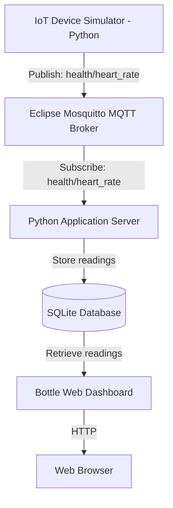

# Secure IoT Health Monitoring System

An event-driven IoT application for collecting, transmitting,
storing and visualizing simulated heart-rate data using MQTT,
Python and SQLite.

Originally developed in August 2024, this repository reconstructs the
documented implementation and serves as a foundation for
further security and scalability improvements.

## Project Overview

The system simulates IoT devices transmitting heart-rate
measurements to a centralized application server through an
MQTT message broker.

The application server processes incoming messages, persists
the readings in a database and provides a web interface for
viewing and filtering historical data.

## System Architecture



The system consists of three containerized services:

- **Device Simulator-Raspberry Pi:** Simulates heart-rate measurements
  from five IoT users.
- **MQTT Broker:** Facilitates asynchronous communication
  between the publisher and subscriber.
- **Application Server:** Processes incoming readings,
  manages database persistence and serves the web dashboard.

## Technology Stack

| Technology        | Purpose                        |
|-------------------|--------------------------------|
| Python 3.11       | Application development        |
| Eclipse Mosquitto | MQTT message broker            |
| MQTT              | Lightweight messaging protocol |
| Paho MQTT         | MQTT client library            |
| Bottle            | Web application framework      |
| SQLite            | Data persistence               |
| Docker            | Containerization               |
| Docker Compose    | Multi-container orchestration  |

## Features

- Simulated IoT heart-rate data generation.
- Asynchronous publisher-subscriber communication.
- MQTT-based message transmission.
- Persistent storage of heart-rate readings.
- Web-based data visualization.
- Search and filtering by device ID.
- Containerized application components.
- Persistent database storage using Docker volumes.

## MQTT Configuration

| Parameter           | Value               |
|---------------------|---------------------|
| Broker              | Eclipse Mosquitto   |
| Port                | 1883                |
| Topic               | health/heart_rate   |
| Message format      | CSV                 |
| Simulated users     | 5                   |
| Heart-rate range    | 60–100 bpm          |
| Publishing interval | 5 seconds per batch |

Example MQTT messages:

```text
John,83
Jane,75
Sarah,92
Rob,68
Steph,87
```

## Getting Started

### Prerequisites

- Docker
- Docker Compose
- Git

### Installation

Build and start the services:

```bash
docker compose up --build -d
```

Verify the running containers:

```bash
docker compose ps
```

Access the dashboard:

http://localhost:8080

### View Application Logs

Device simulator:

```bash
docker compose logs -f device
```

Application server:

```bash
docker compose logs -f server
```

### Monitor MQTT Messages

```bash
docker compose exec broker mosquitto_sub \
  -h localhost -p 1883 -t "health/heart_rate" -v
```

### Stop the Application

```bash
docker compose down
```

Database records are retained in a Docker volume.

## Project Structure

```text
secure-iot-health-monitoring/
├── broker/
│   └── mosquitto.conf
├── device/
│   ├── publisher.py
│   ├── requirements.txt
│   └── Dockerfile
├── server/
│   ├── views/
│   │   └── dashboard.tpl
│   ├── app.py
│   ├── database.py
│   ├── requirements.txt
│   └── Dockerfile
├── docs/
│   └── screenshots/
├── docker-compose.yml
├── .gitignore
└── README.md
```

## Functional Verification

| Test                            | Result |
|---------------------------------|--------|
| Simulated heart-rate generation | Passed |
| MQTT message publishing         | Passed |
| MQTT message subscription       | Passed |
| SQLite data storage             | Passed |
| Web dashboard rendering         | Passed |
| Search by device ID             | Passed |
| Database persistence            | Passed |

## Known Limitations — V1

This release represents the functional baseline of the
original project.

The original project identified unresolved challenges in
security and scalability testing, including:

- Unencrypted MQTT communication.
- Incomplete TLS implementation.
- Lack of effective MQTT client authentication.
- Incomplete topic-level access control.
- Unsuccessful monitoring and load-testing configuration.

The reconstructed baseline intentionally uses plaintext
MQTT and anonymous broker access within a local Docker
network.

It is intended for local development and demonstration,
not production deployment.

## Development Roadmap

### V1 — Reconstructed Baseline

- [x] IoT device simulation
- [x] MQTT publisher and subscriber
- [x] Database persistence
- [x] Web dashboard
- [x] Docker containerization
- [x] Functional verification

### V2 — Security and Scalability Improvements

- [ ] MQTT over TLS
- [ ] Certificate generation and validation
- [ ] MQTT client authentication
- [ ] Topic-level access control lists
- [ ] Improved message validation
- [ ] Structured application logging
- [ ] Prometheus metrics
- [ ] Grafana monitoring dashboards
- [ ] k6 performance testing
- [ ] Automated testing
- [ ] Security verification

## Project History

The original project was developed in August 2024 using
three virtual machine environments representing an IoT
device (Raspberry Pi) , MQTT broker and application server.

This repository contains a reconstruction completed in
November 2026 based on the original project documentation,
architecture and implementation evidence. It is not the
recovered original source code.

The reconstruction introduces Docker Compose for
reproducibility, persistent Docker volumes and a Bottle
dependency compatibility update from 0.12.19 to 0.13.4.

The original messaging format, core technologies and
application functionality have been retained.

## Disclaimer

All heart-rate measurements are simulated. This application
is an educational engineering project and is not intended
for clinical use or processing real patient information just yet.
